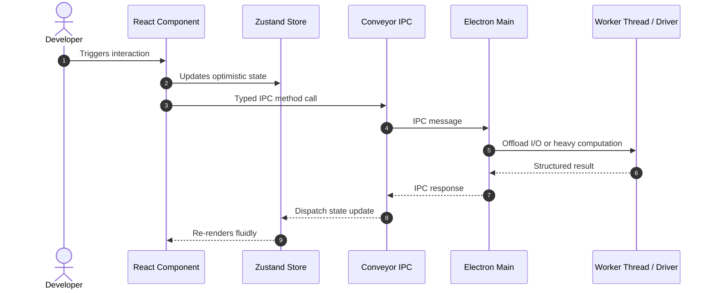

# Technical Architecture Plan: [Feature Name]

**Feature ID**: `[###-feature-name]`  
**Status**: `Draft | Review | Approved | Implemented`  
**Spec Reference**: `spec.md`  

---

## 1. Architectural Strategy & SOLID Alignment

- **Single Responsibility (SRP)**: Detail how components, stores, and utilities partition their responsibilities.
- **Open/Closed (OCP)**: Detail extension points (Strategy pattern, provider registry).
- **Dependency Inversion (DIP)**: Detail how the UI communicates via typed IPC abstractions (`conveyor/`).

---

## 2. Component & Directory Layout

```text
app/features/[feature-name]/
├── components/
│   ├── [component-a]/
│   │   ├── index.tsx       # UI logic and JSX
│   │   └── styles.ts       # styled-components only
│   └── [component-b]/
│       ├── index.tsx
│       └── styles.ts
├── domain/                 # Pure TypeScript business models & algorithms
│   ├── types.ts
│   └── [domain-logic].ts
└── constants.ts            # Feature-specific constants (or app/constants/app-constants.ts)
```

---

## 3. Data Flow & Sequence Diagram



---

## 4. TypeScript Contracts & Interfaces

```typescript
// Insert typed interfaces, contracts, and enums here
```

---

## 5. Security & Verification Strategy
- **Credential & Storage Safety**: Any credential handling with OS `safeStorage`.
- **Quality Gates**:
  - `npm run typecheck`
  - `npm run lint:check`
  - `npm run test:sqlite`

