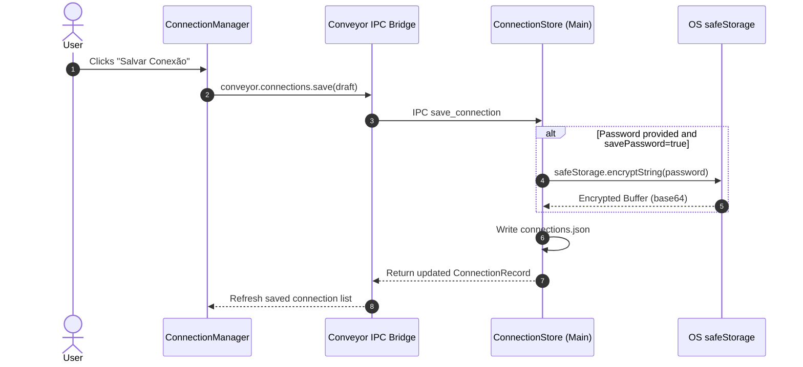

# Technical Architecture Plan: Connection Hub & Secure Credentials

**Feature ID**: `001-connection-management`  
**Status**: `Implemented`  
**Spec Reference**: `spec.md`  

---

## 1. Architectural Strategy & SOLID Alignment

- **Single Responsibility (SRP)**:
  - `connection-manager/`: Container orchestrator.
  - `connection-sidebar/`: History and saved list display.
  - `driver-selector/`: Database engine switching.
  - `connection-fields/`: Driver-specific configuration forms.
  - `connection-identity/`: Metadata and color tag labeling.
  - `url-parser.ts`: Pure URL regex parser utility.
  - `connection-store.ts`: Node.js main process file persistence and encryption.
- **Dependency Inversion (DIP)**:
  - React communicates with connection storage exclusively via typed Conveyor IPC contract `conveyor.connections.*`.

---

## 2. Component & Directory Layout

```text
app/features/connections/
├── components/
│   ├── connection-card-item/
│   │   ├── index.tsx
│   │   └── styles.ts
│   ├── connection-fields/
│   │   ├── index.tsx
│   │   └── styles.ts
│   ├── connection-identity/
│   │   ├── index.tsx
│   │   └── styles.ts
│   ├── connection-sidebar/
│   │   ├── index.tsx
│   │   └── styles.ts
│   ├── driver-selector/
│   │   ├── index.tsx
│   │   └── styles.ts
│   └── url-import-modal/
│       ├── index.tsx
│       └── styles.ts
├── constants.ts
└── url-parser.ts
```

---

## 3. Data Flow



