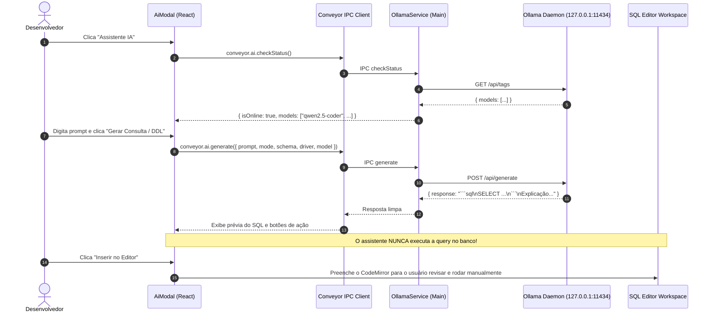

# Technical Architecture Plan: Local AI Assistant (Ollama)

**Feature ID**: `004-local-ai-text-to-sql`  
**Status**: `In Progress`  
**Spec Reference**: `spec.md`  

---

## 1. Architectural Strategy & SOLID Alignment

- **Single Responsibility (SRP)**:
  - `lib/main/ai/ollama-service.ts`: Node.js Main process service communicating exclusively with local Ollama (`http://127.0.0.1:11434`).
  - `conveyor/ai-contracts.ts`: Strictly typed request/response contracts and Zod schemas.
  - `conveyor/modules/ai.ts`: Conveyor IPC router module exposing `status`, `models`, and `generate`.
  - `app/features/ai-assistant/domain/prompt-builder.ts`: Pure schema-to-prompt serialization with driver dialect mapping.
  - `app/features/ai-assistant/domain/response-parser.ts`: Extracts SQL and explanations from model output.
  - `app/features/ai-assistant/components/ai-modal/`: Presentation modal enforcing human review before inserting into the editor.
- **Dependency Inversion (DIP)**:
  - Frontend interacts strictly via `conveyor.ai.*` contracts without any direct Node.js network imports.
- **Zero Database Control Principle**:
  - The AI module has **no IPC access to `databaseService.execute`**. It can only return strings back to the renderer.

---

## 2. Component & Directory Layout

```text
lib/main/ai/
└── ollama-service.ts               # Local HTTP client (health, list models, generate)

conveyor/
├── ai-contracts.ts                 # Contracts & Zod schemas
└── modules/
    └── ai.ts                       # Conveyor IPC endpoints

app/features/ai-assistant/
├── components/
│   ├── ai-modal/
│   │   ├── index.tsx               # Main assistant modal (tabs, preview, actions)
│   │   └── styles.ts               # styled-components only
│   ├── ai-status-badge/
│   │   ├── index.tsx               # Online/offline status pill
│   │   └── styles.ts
│   └── ai-trigger-button/
│       ├── index.tsx               # Toolbar sparkler trigger button
│       └── styles.ts
├── domain/
│   ├── prompt-builder.ts           # Schema context formatting & prompt engineering
│   ├── response-parser.ts          # Codeblock extraction & sanitization
│   └── types.ts                    # UI-specific types (modes, state)
└── constants.ts                    # Defaults, timeout, prompt templates
```

---

## 3. Communication Sequence


