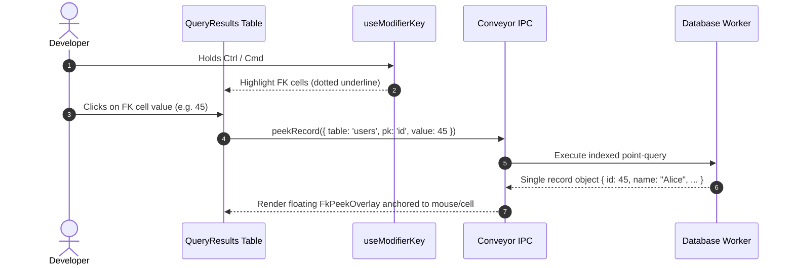

# Technical Architecture Plan: IDE-Style Data Navigation (Foreign Key Peek Overlay)

**Feature ID**: `005-foreign-key-peek`  
**Status**: `Ready for Implementation`  
**Spec Reference**: `spec.md`  

---

## 1. Architectural Strategy & SOLID Alignment

- **Single Responsibility (SRP)**:
  - `foreign-key-resolver.ts`: Pure schema metadata mapper linking FK columns to parent tables and PKs.
  - `fk-peek-overlay/`: Floating card presentation with loading state, error state, and key-value inspector.
  - `databaseWorker.ts`: Executes fast single-row indexed lookup query.
- **Dependency Inversion (DIP)**:
  - The UI requests the referenced record via typed method `conveyor.database.peekRecord({ path, targetTable, pkColumn, value })`.

---

## 2. Component & Directory Layout

```text
app/features/fk-navigation/
├── components/
│   └── fk-peek-overlay/
│       ├── index.tsx
│       └── styles.ts
├── domain/
│   ├── foreign-key-resolver.ts
│   └── types.ts
└── hooks/
    └── use-modifier-key.ts    # Tracks Ctrl/Cmd keyboard state

lib/main/
└── database-worker.ts         # Handles PEEK_RECORD message
```

---

## 3. Communication Sequence



