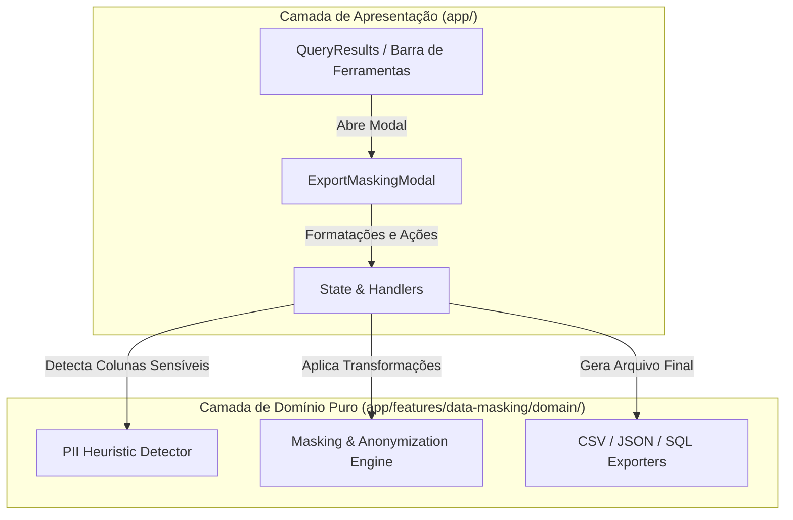

# Technical Architecture Plan: Exportação com Data Masking (LGPD / GDPR)

**Feature ID**: `007-data-masking-export`  
**Status**: `Draft`  
**Spec Reference**: `spec.md`  

---

## 1. Arquitetura e Separação de Camadas

Em conformidade com a Clean Architecture especificada no `AGENTS.md`:



- **Domínio Puro (`app/features/data-masking/domain/`)**:
  - `masking-types.ts`: Definição de `MaskRule`, `SensitiveKind`, `ColumnMaskConfig`, `ExportFormat`.
  - `heuristic-detector.ts`: Heurísticas puras baseadas em regex e nomes de colunas (`email`, `cpf`, `cnpj`, `phone`, `password`, `name`, etc.).
  - `masking-engine.ts`: Transformações puras de mascaramento parcial, dados fictícios sintéticos, hashes e nulos.
  - `export-serializers.ts`: Serializadores puros de CSV, JSON e SQL INSERTs.
- **Componentes React (`app/features/data-masking/components/export-masking-modal/`)**:
  - `index.tsx`: Modal com seletor de formato, lista de colunas com detecção LGPD, regras de máscara e preview em tempo real.
  - `styles.ts`: Todos os styled-components, animações e layout flex/grid.

---

## 2. Contratos e Tipos de Domínio

```typescript
export type SensitiveKind =
  | 'none'
  | 'email'
  | 'cpf_cnpj'
  | 'phone'
  | 'password'
  | 'name'
  | 'credit_card'
  | 'address'
  | 'generic'

export type MaskRule = 'none' | 'mask' | 'fake' | 'hash' | 'null'

export type ExportFormat = 'csv' | 'json' | 'sql'

export interface ColumnMaskConfig {
  columnName: string
  sensitiveKind: SensitiveKind
  rule: MaskRule
}
```

---

## 3. Estratégias de Anonimização

| Tipo Sensível | Regra `mask` (Parcial) | Regra `fake` (Sintético) | Regra `hash` | Regra `null` |
| :--- | :--- | :--- | :--- | :--- |
| **Email** | `g***e@exemplo.com` | `usuario_1@exemplo.local` | `d41d8cd9` | `NULL` |
| **CPF / CNPJ** | `123.***.***-01` | CPF fictício formatado | `4b227777` | `NULL` |
| **Telefone** | `(11) 9****-1234` | `(11) 91234-5678` | `827ccb0e` | `NULL` |
| **Senha / Hash** | `********` | `[SENHA REDIGIDA]` | `098f6bcd` | `NULL` |
| **Nome** | `G******* S****` | `Nome Fictício 1` | `5f4dcc3b` | `NULL` |
| **Cartão** | `**** **** **** 1234` | `4000 0000 0000 0001`| `a665a459` | `NULL` |
| **Genérico** | `***` | `[CONFIDENCIAL]` | Hash curto | `NULL` |

---

## 4. Testes & Quality Gates

- `tests/data-masking.test.ts`:
  - Testes unitários para heurística de detecção de nomes de coluna sensíveis.
  - Testes para funções de mascaramento parcial, dados fakes e hashes.
  - Testes para formatação e escape de CSV, JSON e SQL statements.

