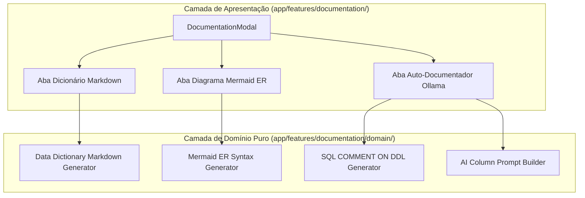

# Technical Architecture Plan: Database Documentation Suite

**Feature ID**: `008-database-documentation-suite`  
**Status**: `Draft`  
**Spec Reference**: `spec.md`  

---

## 1. Arquitetura e Clean Architecture

Seguindo rigorosamente o `AGENTS.md`:



- **Domínio Puro (`app/features/documentation/domain/`)**:
  - `types.ts`: Tipos para metadados de tabelas, colunas, chaves estrangeiras, comentários e sugestões de IA.
  - `dictionary-generator.ts`: Função pura `generateMarkdownDictionary(options): string`.
  - `mermaid-generator.ts`: Função pura `generateMermaidErDiagram(options): string`.
  - `sql-comment-generator.ts`: Função pura `generateCommentStatements(driver, comments): string`.
  - `ai-documenter-prompt.ts`: Monta o prompt enxuto e estritamente esquemático (sem dados de linhas) para inferência semântica.
- **Camada de Apresentação (`app/features/documentation/components/documentation-modal/`)**:
  - `index.tsx`: Modal com abas temáticas, visualizador com destaque de código, botões de cópia e execução DDL.
  - `styles.ts`: Styled-components isolados consumindo variáveis do design system (`var(--surface)`, `var(--brand)`, etc.).

---

## 2. Contratos e Tipos Principais

```typescript
export interface TableDocumentationMeta {
  name: string
  kind: 'table' | 'view'
  columns: DatabaseColumn[]
  foreignKeys: DatabaseForeignKey[]
  comment?: string
}

export interface ColumnCommentSuggestion {
  tableName: string
  columnName: string
  suggestedComment: string
  applied: boolean
}
```

---

## 3. Segurança e Privacidade (Privacy-First)

- A análise de IA para documentação de colunas envia **apenas nomes de tabelas e colunas** para o Ollama local (`127.0.0.1:11434`), mantendo total conformidade com a seção 4.2 do `AGENTS.md`. Zero dados de linhas são trafegados.
- As alterações de `COMMENT ON` exigem confirmação explícita do usuário antes de serem executadas contra o banco de dados.

