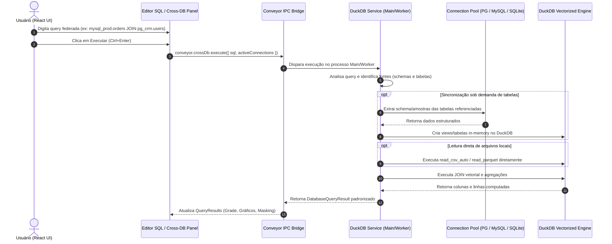

# Plano Técnico: Cross-Database Queries via DuckDB

## 1. Arquitetura e Separação de Camadas



---

## 2. Contratos Conveyor (`conveyor/cross-db-contracts.ts`)

```typescript
export interface CrossDbExecuteInput {
  sql: string
  connectionIds?: string[]
}

export interface CrossDbSource {
  id: string
  name: string
  driver: 'sqlite' | 'postgres' | 'mysql'
  tables: string[]
}

export interface CrossDbCatalog {
  sources: CrossDbSource[]
}
```

---

## 3. Implementação do Motor DuckDB (`lib/main/cross-db/duckdb-service.ts`)

- Utiliza o pacote `duckdb` oficial em memória (`:memory:`).
- Mapeia cada conexão registrada para um esquema ou prefixo seguro no DuckDB (ex: `mysql_prod_orders` ou views `mysql_prod.orders`).
- Suporta leitura nativa de arquivos locais: `.csv`, `.tsv`, `.parquet`, `.json`.
- Implementa tratamento de erros amigável com destaque para tabelas ou arquivos não encontrados.

---

## 4. Integração na Apresentação (`app/features/cross-db/`)

- Adiciona modo de consulta "DuckDB (Cross-DB / ETL)" no seletor de motores da barra de ferramentas ou aba de consulta.
- Painel lateral / drawer de fontes disponíveis:
  - Lista de bancos conectados com suas tabelas e o comando de exemplo para usar no SQL.
  - Botão "Anexar Arquivo Local" para selecionar `.csv` ou `.parquet` via diálogo nativo do sistema e inserir o snippet `read_csv_auto(...)` no editor.
- Atende 100% à regra de isolamento de estilos em `styles.ts` e lógica em `index.tsx`.

